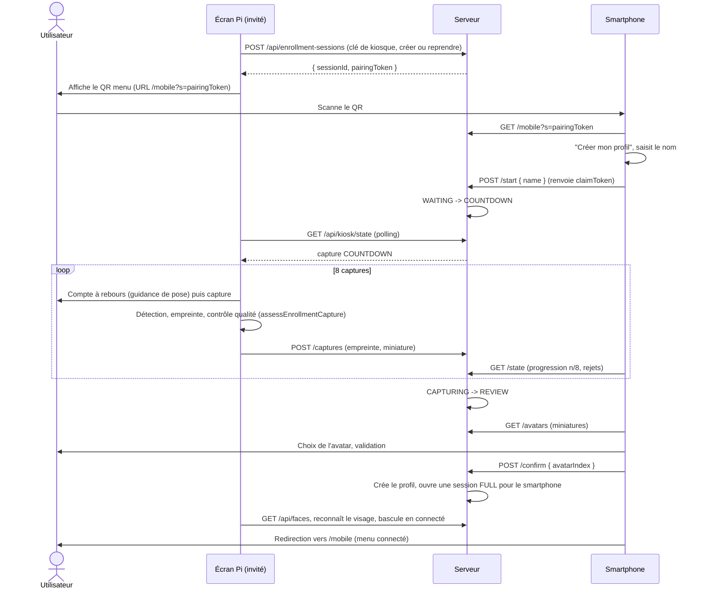
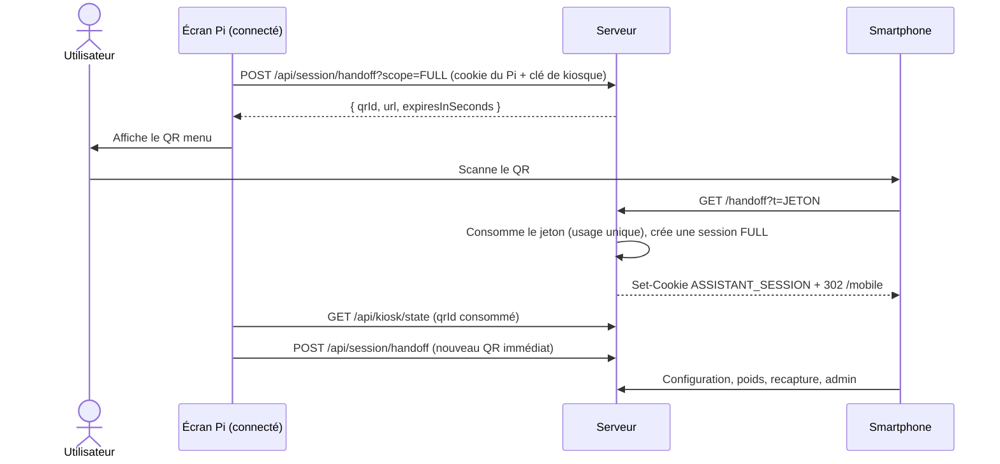

# Parcours QR code : enrôlement et configuration depuis un smartphone

Document de cadrage destiné à `/opsx:propose`. Il décrit les décisions retenues, les parcours cibles, la conception technique et les vérifications à faire. Rien de ce document n'est encore implémenté. Il sera livré en **un seul changement OpenSpec**, qui constitue la **version majeure 1.0.0**.

## 1. Contexte et décisions retenues

Le Raspberry Pi 4 affiche l'application en plein écran dans un navigateur (`http://localhost:8080`). L'écran **n'est pas tactile**. Le smartphone, sur le même réseau local, sert de clavier et de télécommande : il saisit, déclenche et valide ; le Pi voit (caméra) et affiche.

### 1.1 Décisions

| # | Sujet | Décision |
|---|---|---|
| 1 | Livraison | Un seul changement OpenSpec, version **1.0.0** (`pom.xml`, `CHANGELOG.md` avec `[Added]`, `[Changed]`, `[Fixed]`, `[Removed]`), tag git `v1.0.0` pour l'image Docker versionnée (pipeline inchangé) |
| 2 | Captures d'enrôlement | Prises par la **caméra du Pi**, déclenchées depuis le smartphone ; **8 captures** ; compte à rebours initial 5 s puis une prise toutes les 4 s ; textes de guidance de pose |
| 3 | Nombre de photos | **Une seule propriété** `assistant.enrollment.photos` (défaut 8), qui remplace `min-photos` et `max-photos` |
| 4 | Ancien enrôlement | La page `/enroll` et le mode « refaire mes captures » au clavier sont **supprimés** |
| 5 | QR | Un **QR menu toujours affiché** sur le Pi, et un **QR poids** affiché uniquement dans le widget poids |
| 6 | Session du smartphone | **Transitoire** (pas d'appairage durable) |
| 7 | Poids | Widget poids sans retournement : graphique + QR poids. Ajout, modification et suppression d'une mesure **uniquement sur le mobile** |
| 8 | Réseau | **HTTP sur le LAN**, sans Caddy, sans certificat, sans nom de domaine ; QR par **adresse IP** du Pi |
| 9 | Administration | Les pages `/admin/**` sont adaptées au mobile (adaptation **complète**) ; lien « Administration » dans le menu invité **et** connecté |
| 10 | Clé de kiosque | **Incluse dès ce changement** (`ASSISTANT_KIOSK_KEY`) |
| 11 | Mode développement des QR | `assistant.qr.dev-mode` regroupe trois aides : QR cliquable (nouvel onglet, simulation du scan), URL affichée sous le QR, bascule automatique `localhost` ⇄ `127.0.0.1`. **Désactivé en production**, activé en profil `local` |
| 12 | Régénération | Les jetons de QR sont à **usage unique** et le QR est **régénéré immédiatement** après consommation |
| 13 | Transport temps réel | Polling court (pas de SSE) ; états en mémoire (pas de table) |
| 14 | Poids : taille du QR | QR poids petit dans un petit emplacement : accepté |

### 1.2 Hors périmètre

- Appairage durable d'un smartphone à un profil.
- Enrôlement d'un tiers depuis un profil connecté (pas de bouton « ajouter un profil »).
- Détection réelle de la pose du visage (le guidage est un texte seul).
- HTTPS, certificats, noms de domaine.

## 2. État actuel du code (constats vérifiés)

- Identification : le navigateur calcule l'empreinte du visage (face-api) et envoie seulement `profileId` à `POST /api/auth/login` ([AuthController](../src/main/java/com/assistant/auth/AuthController.java)). Aucune preuve n'est exigée côté serveur (voir 6).
- Session : cookie `ASSISTANT_SESSION` (HttpOnly, SameSite=Strict, `Secure` seulement si la requête est sécurisée), jeton de 32 octets haché en SHA-256 dans `app_session` ([SessionService](../src/main/java/com/assistant/auth/SessionService.java), [SessionCookies](../src/main/java/com/assistant/auth/SessionCookies.java)).
- `login()` ne ferme que la session précédente **du même appareil** : plusieurs sessions simultanées pour un même profil sont possibles (Pi + smartphone).
- `heartbeat` prolonge la session glissante ; il est émis par le Pi quand le visage est revu ([home.js](../src/main/resources/static/js/home.js)).
- Invité : `SessionInterceptor` retourne le profil invité sur les endpoints `@AllowGuest` quand il n'y a pas de session. Le widget poids n'est pas autorisé aux invités (`guestAllowed` non surchargé).
- `POST /api/profiles` n'exige aucune session ; limites : `assistant.enrollment.max-profiles` et le contrôle de doublon de visage (409).
- Pages existantes : `/enroll` (accessible sans session, appelle `api.login` puis redirige vers `/`), `/configuration` (`@RequireSession`, grille de 5 emplacements), `/admin/**` (3 templates : `login.html`, `index.html`, `guest.html`).
- Poids : [WeightController](../src/main/java/com/assistant/profile/WeightController.java) (`@RequireSession`, `GET/POST/PUT/DELETE /api/weight`, valeur `^[0-9]{1,3}(?:[.,][0-9])?$`, stockage en dixièmes de kg). Le widget actuel a deux faces : graphique, puis « 3 dernières mesures + formulaire ».
- Sécurité HTTP : `/api/**` ouvert côté Spring Security et sans CSRF ; l'autorisation repose sur l'intercepteur de session ([AdminSecurityConfig](../src/main/java/com/assistant/admin/AdminSecurityConfig.java)).
- Déploiement actuel (**à supprimer**) : `docker-compose.yml` fournit Caddy (`tls internal`, `ASSISTANT_DOMAIN`, `/root.crt`), l'app en `expose: 8080`, `server.forward-headers-strategy=framework`, cookie admin `Secure` par défaut. Spec : `openspec/specs/https-deployment`.
- Caméra : [camera.js](../src/main/resources/static/js/camera.js) exige `window.isSecureContext` ; `http://localhost` en est un, pas `http://<ip>`. Le smartphone n'utilisant plus la caméra, seul le Pi est concerné.
- Test utilisateur : la reconnaissance à 1 m a fonctionné.

## 3. Parcours cibles

### 3.1 Le QR menu : un seul QR, deux visages

```
 PI INVITÉ                                   PI CONNECTÉ
 ┌──────────────┐                            ┌──────────────┐
 │  QR menu     │  /mobile?s=<pairing>       │  QR menu     │  /handoff?t=<jeton FULL>
 └──────┬───────┘                            └──────┬───────┘
        ▼                                           ▼
 /mobile (invité)                            /mobile (connecté)
  ├─ Créer mon profil → /mobile/enroll         ├─ Configuration → /configuration
  └─ Administration   → /admin/login           ├─ Poids → /mobile/weight
                                               ├─ Refaire mes captures
                                               ├─ Administration → /admin/login
                                               └─ Se déconnecter
```

Le QR menu est **toujours affiché**, à un emplacement fixe hors des cinq emplacements de widgets (placement exact à préciser à la conception). Pendant une capture, il est remplacé par le panneau plein écran de guidage, puis revient.

### 3.2 Parcours A : enrôlement (Pi invité, captures sur la caméra du Pi)

Le smartphone ne sert ni de caméra ni de calcul : il saisit le nom, lance la capture, choisit l'avatar et valide.



Machine à états de la session de capture (serveur, en mémoire) :

```
WAITING --start--> COUNTDOWN --> CAPTURING --(8 captures valides)--> REVIEW --confirm--> DONE
   |                                  |                                  |
   +---- expiration / annulation (Pi ou smartphone) / visage connu reconnu ---> CANCELLED / EXPIRED
```

Règles :

- **Rythme** : compte à rebours initial de 5 s, puis une capture toutes les 4 s, soit environ **37 s** pour 8 captures valides, plus les rejets.
- **Nombre** : exactement `assistant.enrollment.photos` captures **valides** (défaut 8).
- **Captures rejetées** (visage absent, trop petit, plusieurs visages, visage déjà connu d'un autre profil) : la prise est reprise au compte à rebours suivant, avec message sur le Pi et le smartphone. Abandon après `max-consecutive-failures` (3) échecs consécutifs et retour à `WAITING`.
- **Guidance de pose** : texte seul, défilant à chaque prise (par exemple : « de face », « légèrement à gauche », « légèrement à droite », « menton un peu haut », « menton un peu bas », …), séquence fixe en code, répétée si le nombre de photos dépasse la liste.
- **Premier téléphone gagnant** : `/start` renvoie un `claimToken` exigé par les appels suivants (`/restart`, `/confirm`, `DELETE`) ; un autre smartphone qui scanne le même QR après le démarrage reçoit « Enrôlement déjà en cours ».
- **Pilotage côté Pi** : réutilise le flux caméra déjà ouvert par `home.js`, `assessEnrollmentCapture` et `createRecognizer`. Le Pi ne change pas de page ; il passe en mode « capture à distance » et **met en pause la boucle de reconnaissance** pour éviter tout login ou bascule parasite.
- **Visage connu pendant `WAITING`** : si un profil existant est reconnu, il se connecte normalement et la session de capture est annulée (le QR menu devient le QR connecté).
- **`REVIEW`** : le smartphone peut « Relancer » (retour à `COUNTDOWN`, captures effacées) ou valider. Les miniatures d'avatar sont conservées en mémoire pendant la session, jamais sur disque.
- **Fin** : le smartphone redirige vers `/mobile` (menu connecté) ; le Pi reconnaît le visage avec ses propres captures puis affiche « Bonjour … ». Après un enrôlement ou un abandon, le Pi revient à l'état invité avec un nouveau QR.

### 3.3 Parcours B : menu et configuration (Pi connecté)



Le cookie du Pi n'est jamais copié : un **jeton à usage unique** est échangé contre une **nouvelle session** du même profil. Le smartphone peut ensuite ouvrir `/configuration` (vue liste adaptée au mobile), `/mobile/weight`, lancer une recapture ou aller sur l'administration.

### 3.4 Parcours C : poids

Le widget poids du Pi affiche le **graphique** et le **QR poids** (portée `WEIGHT`). Ce QR n'existe que dans ce widget, donc seulement si l'utilisateur connecté a le widget actif et placé.

```
 Avant                                    Après
 ┌──────────────┐  clic  ┌──────────┐     ┌────────────────────────┐
 │  Graphique   │ ─────► │ 3 mesures│     │  Graphique   │  QR     │
 │              │        │ formulaire│    │              │  poids  │
 └──────────────┘        └──────────┘     └────────────────────────┘
```

La page `/mobile/weight` regroupe tout ce que l'ancienne face arrière faisait : liste paginée des mesures, **ajout** (date du jour, champ pré-rempli avec le dernier relevé, clavier décimal), **modification** et **suppression**. Widget sans mesure : graphique vide, QR et message « Scannez pour saisir votre premier poids ».

### 3.5 Parcours D : refaire ses captures

Depuis `/mobile` (session `FULL`), « Refaire mes captures » crée une session de capture de mode `RECAPTURE` liée au profil de la session du smartphone. Le Pi la découvre via `GET /api/kiosk/state`, vérifie que **son propre profil connecté** est bien celui-ci (le serveur le contrôle avec le cookie de session du Pi présent sur chaque appel `kiosk`), puis déroule le même compte à rebours que le parcours A. Le smartphone choisit en `REVIEW` « Remplacer » ou « Ajouter » (équivalent du `replace` de `PUT /api/profiles/{id}/embeddings`) puis valide. Aucune création de profil, pas de choix de nom.

### 3.6 Parcours E : administration sur mobile

Les liens « Administration » mènent à `/admin/login` (authentification propre, session Spring séparée, mot de passe administrateur). Les trois pages (`login.html`, `index.html`, `guest.html`) et `admin.css` / `admin.js` sont rendus utilisables sur petit écran.

## 4. Conception technique

### 4.1 Configuration

| Propriété (variable d'environnement) | Défaut | Rôle |
|---|---|---|
| `assistant.public-base-url` (`ASSISTANT_PUBLIC_BASE_URL`) | vide | URL de base encodée dans les QR, ex. `http://192.168.1.50:8080` ; vide = QR désactivés avec avertissement (logs et écran admin), **sauf en mode développement** (`assistant.qr.dev-mode=true`) où l'URL est dérivée de l'hôte de la requête (`localhost` ⇄ `127.0.0.1`, voir 4.3). Jamais déduite de `window.location` côté client : le serveur construit et renvoie toutes les URL de QR. Validation `^$\|^https?://[^\s/]+(/\S*)?$` sans slash final |
| `assistant.kiosk.key` (`ASSISTANT_KIOSK_KEY`) | vide | Clé partagée avec le navigateur du Pi. **Obligatoire en production** (le démarrage échoue si vide ; contrôle sur le modèle de `AdminStartupConfigurationTest`). Vide en profil `local` = contrôle désactivé avec avertissement |
| `assistant.kiosk.poll-idle-ms` / `poll-active-ms` (`ASSISTANT_KIOSK_POLL_IDLE_MS` / `..._ACTIVE_MS`) | 3000 / 1000 | Intervalle de `GET /api/kiosk/state` au repos et pendant une capture |
| `assistant.enrollment.photos` (`ASSISTANT_ENROLLMENT_PHOTOS`) | 8 | Nombre de captures valides ; remplace `MIN_PHOTOS` et `MAX_PHOTOS` (supprimées) ; borné `@Min(1) @Max(30)` |
| `assistant.enrollment.remote.countdown-seconds` | 5 | Compte à rebours initial |
| `assistant.enrollment.remote.interval-seconds` | 4 | Intervalle entre captures |
| `assistant.enrollment.remote.session-ttl-minutes` | 10 | Durée de vie d'une session de capture (prolongée à chaque interaction) |
| `assistant.enrollment.remote.max-consecutive-failures` | 3 | Échecs consécutifs avant abandon |
| `assistant.handoff.token-ttl-seconds` | 120 | Durée de vie d'un jeton de QR connecté |
| `assistant.handoff.full-session-minutes` | 30 | Durée de la session `FULL` d'un smartphone |
| `assistant.handoff.weight-session-minutes` | 10 | Durée de la session `WEIGHT` |
| `assistant.qr.dev-mode` (`ASSISTANT_QR_DEV_MODE`) | `false` (`true` dans `application-local.properties`) | Active les aides de développement : QR cliquables (nouvel onglet), URL affichée en toutes lettres sous le QR et, si `public-base-url` est vide, dérivation de l'URL des QR en inversant `localhost` et `127.0.0.1` |

Toutes ces propriétés vont dans `AssistantProperties`, `application.properties`, `docker-compose.yml` (valeurs par défaut) et le tableau du README. Les propriétés `assistant.enrollment.min-photos` et `max-photos` sont supprimées (**changement cassant**).

### 4.2 Clé de kiosque (`com.assistant.kiosk`)

Mécanisme : en-tête `X-Kiosk-Key`, comparé en temps constant à `assistant.kiosk.key`. La page du Pi lit `?kiosk=<clé>` à l'ouverture, la conserve en `sessionStorage`, retire le paramètre de l'URL (`history.replaceState`) et l'envoie à chaque appel réservé au Pi. Lancement du navigateur du Pi : `http://localhost:8080/?kiosk=<clé>`.

Endpoints **réservés au Pi** (refus `403` sans clé valide) :

| Endpoint | Rôle |
|---|---|
| `POST /api/auth/login` | Ouverture de session après reconnaissance |
| `POST /api/auth/heartbeat` | Prolongation de la session du Pi (un smartphone ne peut donc pas prolonger sa propre session) |
| `POST /api/session/handoff` | Émission d'un jeton de QR |
| `GET /api/kiosk/state` | Poll d'état du Pi (voir 4.4) |
| `POST /api/enrollment-sessions` | Créer ou reprendre la session de capture |
| `POST /api/enrollment-sessions/{id}/captures` | Dépôt d'une capture ou d'un rejet |
| `DELETE /api/enrollment-sessions/{id}` (appel du Pi) | Annulation côté Pi |

Puisque l'ancienne page `/enroll` disparaît, `POST /api/auth/login` n'a plus que le Pi pour appelant : le protéger ne coûte rien et ferme le contournement par simple `profileId`.

### 4.3 QR : types, régénération, affichage

| QR | Où | URL encodée | Jeton | Cible |
|---|---|---|---|---|
| Menu (invité) | Pi, toujours | `<base>/mobile?s=<pairingToken>` | `pairingToken` de la session de capture (valable tant que la session vit) | `/mobile` invité |
| Menu (connecté) | Pi, toujours | `<base>/handoff?t=<jeton>` | Jeton `FULL`, usage unique, TTL 120 s | `/mobile` connecté |
| Poids | Widget poids seulement | `<base>/handoff?t=<jeton>` | Jeton `WEIGHT`, usage unique, TTL 120 s | `/mobile/weight` |

**Régénération immédiate.** Chaque QR émis a un `qrId` opaque. Le Pi l'envoie dans `GET /api/kiosk/state` ; la réponse donne l'état de chaque `qrId` (`ACTIVE`, `CONSUMED`, `EXPIRED`). Dès `CONSUMED` ou `EXPIRED`, le Pi redemande un jeton et redessine le QR (au plus 3 s après un scan, avec la valeur par défaut du poll). Le Pi renouvelle aussi un QR 15 s avant son TTL : l'ancien reste valide jusqu'à sa consommation ou son expiration (délai de grâce), au plus deux jetons actifs par type. Le QR invité change quand la session de capture est renouvelée (nouvelle valeur de `pairingToken`).

**Rendu** : bibliothèque JS embarquée sous `/vendor/` (le Pi fonctionne sans CDN), SVG, MIT, contraste fort ; assez grand pour un scan à 1-2 m dans le QR menu ; dans le widget poids la taille suit l'emplacement (petit emplacement : QR petit, accepté).

**QR cliquable** (`assistant.qr.dev-mode=true`) : le QR est enveloppé dans un lien `<a target="_blank" rel="noopener">` vers son URL, avec info-bulle « Simuler le scan », et l'URL est affichée en toutes lettres sous le QR. Désactivé en production (aucun lien, pas d'URL affichée). Le clic consomme le jeton comme un vrai scan, donc le QR se régénère tout seul.

**Mode développement : bascule automatique `localhost` ⇄ `127.0.0.1`.** Un onglet ouvert par le clic partage les cookies de la page du Pi s'ils ont le même nom d'hôte : le `handoff` écraserait la session du Pi (en particulier avec un jeton `WEIGHT`). Un composant `QrUrlResolver` construit donc toutes les URL de QR côté serveur selon cette règle :

1. `assistant.public-base-url` renseignée : elle est utilisée telle quelle ;
2. sinon, si `assistant.qr.dev-mode=true` et que l'hôte de la requête est exactement `localhost` ou `127.0.0.1` : l'URL reprend le schéma et le port de la requête avec l'**autre** hôte (page sur `localhost:8080` → QR sur `127.0.0.1:8080`, et inversement) ; les deux hôtes ont des cookies séparés, donc le « téléphone » simulé ne touche pas la session de la page du Pi ;
3. sinon : pas de QR, avertissement dans les logs.

Aucun autre hôte n'est refleté dans une URL de QR (pas d'injection par l'en-tête `Host`). Les endpoints qui renvoient un QR (`POST /api/enrollment-sessions`, `POST /api/session/handoff`) renvoient l'URL complète ; le Pi n'assemble aucune URL. Une fenêtre de navigation privée reste une alternative.

### 4.4 Backend : session de capture à distance

Nouveau `EnrollmentSessionService` et `EnrollmentSessionController`. Une **seule session active** (un seul Pi), en mémoire (`ConcurrentHashMap`), purgée par une tâche planifiée calquée sur [SessionPurgeTask](../src/main/java/com/assistant/auth/SessionPurgeTask.java).

| Champ | Rôle |
|---|---|
| `id`, `state`, `mode` (`CREATE`/`RECAPTURE`), `profileId` (recapture) | identité et état |
| `pairingTokenHash` | secret du QR invité (la recapture n'en a pas : elle est lancée depuis une session `FULL`) |
| `claimTokenHash` | secret du premier smartphone qui lance la capture |
| `name` | nom saisi (validé comme dans `ProfileService`) |
| `captures[]` | empreintes (128 flottants) + miniature d'avatar ; au plus `photos` |
| `countdownStartsAtMs`, `nextShotAtMs`, `consecutiveFailures`, `guidanceIndex` | synchronisation et guidage |
| `expiresAtMs` | TTL, prolongé à chaque interaction |

Endpoints (Swagger complet : `@Tag`, `@Operation`, `@ApiResponse` 200/201/400/401/403/404/409/500) :

| Méthode | URL | Appelant | Rôle |
|---|---|---|---|
| `POST` | `/api/enrollment-sessions` | Pi (clé) | **Créer ou reprendre** la session de capture invité ; renvoie `id`, `pairingToken` et `qrUrl` (URL complète construite par le serveur, voir 4.3) |
| `POST` | `/api/enrollment-sessions/recapture` | smartphone (session `FULL`) | Crée une session `RECAPTURE` pour le profil de la session et renvoie un `claimToken` ; la capture démarre ensuite par `/start` (sans nom) |
| `GET` | `/api/enrollment-sessions/{id}/state` | smartphone (`pairingToken` ou `claimToken`) | État, nom, progression, compte à rebours, motifs de rejet, `serverNowMs` |
| `POST` | `/api/enrollment-sessions/{id}/start` | smartphone | `WAITING` vers `COUNTDOWN` ; exige un nom valide en mode `CREATE` ; renvoie `claimToken` (mode `CREATE`) |
| `POST` | `/api/enrollment-sessions/{id}/captures` | Pi (clé) | Dépose une capture (empreinte + miniature) ou un rejet avec motif |
| `GET` | `/api/enrollment-sessions/{id}/avatars` | smartphone (`claimToken`) | Miniatures en `REVIEW`, séparées de `/state` pour garder celui-ci léger |
| `POST` | `/api/enrollment-sessions/{id}/restart` | smartphone (`claimToken`) | Efface les captures, retour à `COUNTDOWN` |
| `POST` | `/api/enrollment-sessions/{id}/confirm` | smartphone (`claimToken`) | Choix de l'avatar (et `replace` en recapture) ; crée le profil via `ProfileService.create` ou met à jour via `updateEmbeddings` ; ouvre une session `FULL` pour le smartphone (`loginFromHandoff`, source `HANDOFF`) |
| `DELETE` | `/api/enrollment-sessions/{id}` | Pi (clé) ou smartphone (`claimToken`) | Annule |
| `GET` | `/api/kiosk/state` | Pi (clé) | `{ serverNowMs, qr: [{qrId, state}], capture: {id, state, mode, countdownStartsAtMs, nextShotAtMs, done, total, guidanceIndex} \| null }` ; sert aussi à découvrir une recapture demandée depuis le mobile |

Tous les tokens (`pairing`, `claim`) sont stockés hachés (SHA-256, comme `SessionService.hash`). Pour la recapture, le Pi n'accepte la session que si le profil de **son** cookie de session égale `profileId`, et le serveur le vérifie sur chaque dépôt de capture.

Synchronisation : chaque réponse contient `serverNowMs` ; les deux écrans calculent le compte à rebours à partir de `countdownStartsAtMs` et `nextShotAtMs` fixés par le serveur, pour absorber la latence du polling.

### 4.5 Backend : jeton de transfert et sessions à portée

`HandoffService` (`com.assistant.auth`) :

- `issue(session, scope)` : `SecureRandom` 32 octets Base64URL, hash SHA-256 stocké **en mémoire** avec `profileId`, `scope`, `qrId`, `expiresAt` ; plafond du nombre de jetons actifs (par profil et global) ; purge planifiée. Le Pi émet uniquement pour **le profil de sa propre session** (jamais un `profileId` fourni).
- `redeem(token)` : atomique (suppression + lecture), usage unique ; marque le `qrId` `CONSUMED` pour le poll du Pi.
- `GET /handoff?t=` : consomme le jeton, crée la session via une nouvelle méthode `SessionService.loginFromHandoff(profileId, scope, durationMinutes)` **sans** `previousToken`, pose le cookie, `302` vers `/mobile` (`FULL`) ou `/mobile/weight` (`WEIGHT`). En-têtes `Cache-Control: no-store` et `Referrer-Policy: no-referrer` ; la query string n'est pas journalisée. Échec : page « QR expiré, scannez à nouveau ».

Portée de session :

- Colonnes ajoutées à `app_session` : `scope` (`varchar(16)`, défaut `FULL`) et `source` (`FACE` ou `HANDOFF`). `ddl-auto` les crée ; vérifier la compatibilité avec une base **existante** SQLite et PostgreSQL.
- `AuthenticatedSession` porte `scope`. Une session `WEIGHT` n'est valide que sur : `/api/weight/**`, `/mobile/weight` et ses ressources statiques, `/api/auth/session`, `/api/auth/logout` (**liste blanche** ; tout le reste répond `403`).
- Les sessions du smartphone ne sont **jamais prolongées** (le heartbeat est réservé au Pi) : durée fixe `full-session-minutes` ou `weight-session-minutes`.
- La session du smartphone survit à la déconnexion du Pi jusqu'à son expiration.

Révocation : les jetons de transfert et sessions de capture en mémoire sont purgés à la suppression d'un profil (`ProfileDeletedEvent`), à `invalidateAll` et à la restauration d'une sauvegarde.

### 4.6 Frontend Pi (`home.js`, `index.html`)

- Composant « Panneau QR » : QR menu toujours visible (invité : `pairingToken` ; connecté : jeton `FULL`) ; un mode « capture » plein écran (grand compte à rebours, texte de guidance, cadre du visage, état « Un téléphone est connecté » dès le scan) qui masque le QR pendant la capture.
- Module `remote-enrollment.js` appelé par `home.js` : poll `GET /api/kiosk/state` (3 s au repos, 1 s en capture) ; sur `COUNTDOWN` suspend la boucle de reconnaissance ; pour chaque prise calcule le compte à rebours depuis `nextShotAtMs`, appelle `recognizer.detect` puis `assessEnrollmentCapture`, génère la miniature, envoie ; sur `REVIEW`, `DONE`, `CANCELLED`, `EXPIRED` reprend la reconnaissance et rafraîchit `GET /api/faces` immédiatement.
- La clé de kiosque est lue dans l'URL de lancement (4.2) et envoyée sur les appels réservés au Pi, y compris `login` et `heartbeat` existants.
- Libération de tous les timers, images et SVG à chaque changement d'état (kiosque 24/7).
- Reprise du widget : `loadProfileApps()` périodique ou sur `visibilitychange` pour refléter poids ou configuration modifiés sur le mobile.

### 4.7 Frontend smartphone

| Page | Contenu |
|---|---|
| `/mobile` | Menu adapté à l'état : invité (`?s=` valide) = « Créer mon profil » et « Administration » ; connecté (session `FULL`) = « Configuration », « Poids », « Refaire mes captures », « Administration », « Se déconnecter » ; sans jeton ni session : « Scannez le QR affiché sur l'écran » et « Administration » |
| `/mobile/enroll` | Nom, « Lancer la capture », progression (n/8, rejets), choix de l'avatar, validation, annulation ; le `pairingToken` est mis en `sessionStorage` puis retiré de l'URL. Aucune caméra ni face-api |
| `/mobile/weight` | Liste paginée, ajout (pré-rempli au dernier relevé, `inputmode="decimal"`, validation identique à `WEIGHT_VALUE`), modification, suppression |
| `/configuration` | Vue liste sur petit écran (position + interrupteur d'activation par application) ; la grille de 5 emplacements reste sur grand écran ; réglages des widgets utilisables sur mobile, sans caméra ni modèles face-api |
| `/admin/**` | `login.html`, `index.html`, `guest.html`, `admin.css`, `admin.js` adaptés au mobile |

Si la session expire (401) : message « Scannez à nouveau le QR sur l'écran ». Réutiliser `api.js` et `theme.css`.

### 4.8 Suppression de l'ancien enrôlement

| Élément | Sort |
|---|---|
| `enroll.html`, `enrollment.js`, `enrollment.css` | Supprimés |
| `HomeController` (`/enroll`) et `AdminSecurityConfig` (`/enroll` ouvert) | Retirés ; `/mobile/**` et `/handoff` ouverts |
| En-tête (`profile-header.html`) : « Créer un profil » et « Refaire mes captures » ; références dans `home.js`, `profile-menu.js`, `configuration.js` | Retirés |
| `enrollment-policy.js` | **Conservé** (réutilisé par la capture à distance) ; `canChooseAvatar` et `canSaveEnrollment` simplifiés vers « exactement N » |
| Tests JS et Java de l'ancien enrôlement | Supprimés ou adaptés |
| `assistant.enrollment.min-photos` / `max-photos` | Remplacés par `assistant.enrollment.photos` |

Conséquence assumée : plus de moyen de créer un profil sans smartphone (un développeur peut ouvrir l'URL du QR, cliquable en mode développement, dans un navigateur de bureau).

### 4.9 Widget poids

- `weight.html` : plus de face arrière ni de formulaire ; graphique + QR poids (portée `WEIGHT`, jeton usage unique, régénération par le poll du Pi).
- `weight.js` et CSS `weight-card-*` / `weight-form` : retrait du retournement, de l'historique et du formulaire ; mise à jour des tests JS.
- QR poids affiché seulement pour un profil connecté (le widget n'est pas autorisé aux invités).

### 4.10 Réseau : HTTP sur le LAN

| Sujet | Décision |
|---|---|
| Accès du Pi | `http://localhost:8080/?kiosk=<clé>` (contexte sécurisé : caméra et face-api fonctionnent) ; **jamais** `http://<ip>:8080` depuis le Pi lui-même |
| Compose | Retirer le service `caddy`, `configs.caddyfile`, volumes `caddy_data`/`caddy_config`, `depends_on: caddy`, `HTTPS_PORT`, `HTTP_PORT`, `ASSISTANT_DOMAIN`, `mem_limit: 64m` ; remplacer `expose: 8080` par `ports: ["${APP_PORT:-8080}:8080"]` ; ajouter les nouvelles variables avec valeurs par défaut |
| Cookie de session faciale | Non `Secure` en HTTP (comportement voulu, sans changement de code) |
| Cookie admin | `SERVER_SERVLET_SESSION_COOKIE_SECURE` passe à `false` par défaut ; sinon le cookie `Secure` est rejeté en HTTP et la connexion `/admin` échoue depuis un smartphone ou un autre poste |
| `forward-headers-strategy=framework` | Passer à `none` (plus de proxy) ; vérifier qu'aucun autre comportement n'en dépend |
| URL des QR | `ASSISTANT_PUBLIC_BASE_URL=http://<ip-du-pi>:8080` ; **réservation DHCP obligatoire** (ou IP statique) du Pi |
| Nom de domaine | Aucun (ni DNS, ni mDNS) |
| Réseau | Désactiver l'isolation des clients Wi-Fi (« AP isolation ») ; n'ouvrir 8080 qu'au sous-réseau local ; aucune redirection de port depuis Internet ; ne pas publier PostgreSQL |
| Spec `https-deployment` | Retirée ou transformée en spec de déploiement LAN HTTP ; conserver « ressources limitées » et « stack compatible Portainer/Arcane » sans Caddy |

### 4.11 Ressources (Raspberry Pi 4, 4 Go)

- Aucune dépendance Java supplémentaire (QR côté client) ; gain mémoire par le retrait de Caddy (64 Mo).
- États en mémoire plafonnés (un seul état de capture, jetons plafonnés), tâches de purge légères.
- Pas de WebSocket ni de SSE ; deux polls légers seulement (`/api/kiosk/state`, `/state` du smartphone pendant la capture).
- Les listes restent paginées (`/api/weight`).

### 4.12 Base de données

- Seule évolution : colonnes `scope` et `source` de `app_session`. Pas d'outil de migration (Hibernate `ddl-auto`).
- Mettre à jour [database.puml](database.puml) (règle de modélisation).
- Jetons de transfert et sessions de capture : hors base, pour limiter les écritures sur la carte SD.

### 4.13 Version, changelog et livraison

- `pom.xml` : `0.0.13` vers `1.0.0`.
- `CHANGELOG.md` : entrée `[1.0.0]` avec `[Added]` (QR menu et poids, capture à distance, clé de kiosque, pages `/mobile/**`, jetons de transfert), `[Changed]` (déploiement HTTP, propriété `photos`, widget poids, administration mobile, login protégé), `[Fixed]` (le cas échéant), `[Removed]` (Caddy, `/enroll`, `min-photos`/`max-photos`).
- Le pipeline GitHub Actions n'est pas modifié ; poser le tag `v1.0.0` produit l'image taguée.
- README : parcours, variables d'environnement (nom, défaut, rôle), lancement du kiosque avec la clé, configuration réseau (IP fixe, isolation Wi-Fi), mode développement (`ASSISTANT_QR_DEV_MODE` : QR cliquable, bascule automatique `localhost` ⇄ `127.0.0.1`), mise en garde HTTP/LAN, migration depuis la 0.x.

## 5. Découpage en blocs (`tasks.md` du changement unique)

Chaque bloc se termine par un point de contrôle (tests verts, application démarrée) et un commit.

| Bloc | Contenu | Prérequis |
|---|---|---|
| 0 | Bascule HTTP : compose (Caddy retiré, port publié), cookie admin, `forward-headers-strategy`, spec de déploiement | - |
| 1 | Configuration : `public-base-url`, clé de kiosque (+ contrôle de démarrage), `photos`, paramètres de capture et de transfert, `qr.dev-mode` | 0 |
| 2 | Clé de kiosque appliquée (`login`, `heartbeat`, endpoints Pi) et envoyée par `home.js` | 1 |
| 3 | Session de capture à distance (serveur) et `GET /api/kiosk/state` | 1, 2 |
| 4 | Pilotage côté Pi : capture, guidage de pose, panneau QR, QR invité | 3 |
| 5 | Jeton de transfert, `loginFromHandoff`, portée `FULL` / `WEIGHT`, colonnes `scope`/`source`, régénération par `qrId`, affichage du QR menu connecté sur le Pi | 2 |
| 6 | Pages mobiles `/mobile`, `/mobile/enroll`, `/mobile/weight` ; confirmation d'enrôlement | 3, 5 |
| 7 | Widget poids : graphique + QR poids, retrait du retournement | 5, 6 |
| 8 | Suppression de l'ancien `/enroll` et nettoyage des menus et propriétés | 4, 6 |
| 9 | `/configuration` en vue liste mobile ; administration mobile (`login`, `index`, `guest`) | 6 |
| 10 | Recapture depuis le mobile (parcours D) | 4, 5, 6 |
| 11 | Version 1.0.0, `CHANGELOG.md`, `README.md`, `database.puml`, specs | tous |

Spécifications à impacter : `profile-enrollment` (réécrite), `face-auth` (login réservé au Pi, portée de session), `guest-dashboard` (QR menu invité), `app-weight` (widget et mobile), `admin-management` (mobile), `https-deployment` (retirée ou transformée), `app-framework` (à vérifier), `data-backup` (la sauvegarde ne doit pas exporter les sessions). Nouvelles capacités suggérées : `remote-enrollment`, `mobile-companion` (menu, transfert, portées), `kiosk-access`.

## 6. Sécurité : inclus et risques acceptés

**Inclus dans ce changement** :

- Clé de kiosque obligatoire en production, sur tous les endpoints réservés au Pi (y compris `login` et `heartbeat`) ; comparaison en temps constant.
- Jetons de transfert et `pairingToken` / `claimToken` : 256 bits d'aléa, stockés hachés, durée de vie courte, usage unique (transfert).
- Portée `WEIGHT` par liste blanche ; sessions du smartphone non prolongeables ; durée fixe.
- Révocation des états en mémoire à la suppression de profil, à `invalidateAll` et à la restauration.
- En-têtes `no-store` et `no-referrer` sur `/handoff`, aucun jeton journalisé, plafond des jetons actifs.
- Une seule session de capture active ; premier smartphone gagnant (`claimToken`).

**Risques acceptés (à rouvrir si le contexte change)** :

| Risque | Remarque |
|---|---|
| Trafic HTTP lisible sur le LAN (jetons, cookies, mot de passe admin) | LAN protégé (WPA2/WPA3, pas de réseau invité partagé) ; `/admin` depuis un poste de confiance |
| QR menu connecté toujours visible : toute personne présente dans la pièce peut scanner | Atténué par l'usage unique et la régénération immédiate ; envisageable plus tard : exiger une présence faciale récente à la consommation |
| Recapture en mode « Remplacer » : un détenteur de session `FULL` peut écraser les empreintes avec un autre visage | À durcir plus tard (n'autoriser que « Ajouter », ou exiger que la capture ressemble aux empreintes existantes) |
| Pas de limitation de débit sur `/handoff`, `/start`, `/state` | À ajouter si besoin |
| `GET /api/faces` accessible sans clé (catalogue de reconnaissance) | Candidat à une protection par la clé de kiosque |
| Pas de page de confirmation avant consommation du jeton (aperçus de liens) | Les applications de scan n'effectuent pas de pré-chargement en pratique ; à revoir si on partage des liens |
| Empreintes faciales = données biométriques | Usage domestique ; message explicite sur le Pi (« Enrôlement en cours… ») ; à rappeler dans le README |
| `SameSite=Strict` et redirection après scan | À valider sur iOS Safari et Android Chrome ; repli : page HTML intermédiaire avec `meta refresh` |

## 7. Points à vérifier au moment de l'implémentation

### 7.1 Fonctionnel
- [ ] Le QR menu est toujours affiché (invité et connecté) et change de contenu au changement d'état.
- [ ] Le panneau de capture masque le QR pendant `COUNTDOWN` / `CAPTURING` et le QR revient ensuite.
- [ ] Compte à rebours synchrone entre Pi et smartphone (`serverNowMs`) ; intervalle réel ≈ 4 s malgré le calcul face-api sur Pi 4 (mesurer ; le calcul ne doit pas décaler la prise suivante).
- [ ] 8 captures valides obligatoires ; rejets repris automatiquement ; abandon après 3 échecs consécutifs avec message clair sur les deux écrans.
- [ ] Textes de guidance cohérents avec le numéro de capture (et répétés si `photos` > longueur de la liste).
- [ ] Pendant la capture la reconnaissance est en pause et reprend à la fin, y compris en cas d'annulation, d'expiration, de perte du smartphone.
- [ ] Un visage connu reconnu pendant `WAITING` annule la session de capture proprement.
- [ ] Deuxième smartphone sur une session déjà lancée : « Enrôlement déjà en cours ».
- [ ] Après `confirm`, le Pi reconnaît le visage rapidement (rafraîchissement immédiat de `/api/faces`) ; retour à l'état invité avec un nouveau QR pour la personne suivante.
- [ ] Jeton consommé (scan ou clic) : nouveau QR affiché en 3 s au plus ; délai de grâce lors du renouvellement avant TTL.
- [ ] Bascule de profil sur le Pi : l'ancien QR connecté est invalidé et remplacé.
- [ ] Déconnexion du Pi : les QR connecté et poids disparaissent et leurs jetons sont révoqués.
- [ ] Widget poids : graphique + QR, état vide, QR absent pour un profil sans widget ; mesure ajoutée sur mobile visible sur le Pi sans rechargement manuel.
- [ ] `/mobile/weight` : liste paginée, ajout, modification, suppression ; validation identique au backend.
- [ ] Recapture : acceptée seulement si le profil connecté sur le Pi est celui de la session ; « Remplacer » et « Ajouter » conformes à `updateEmbeddings`.
- [ ] Limite de profils atteinte : message clair sur le smartphone.

### 7.2 Technique
- [ ] `ddl-auto` ajoute `scope` et `source` sur une base **existante** SQLite et PostgreSQL (valeur par défaut, démarrage sans échec).
- [ ] Les restaurations de sauvegarde continuent de fonctionner et n'embarquent pas les sessions.
- [ ] `redeem` atomique : deux scans simultanés, un seul gagne.
- [ ] Timers et états sans fuite (mémoire côté serveur et JS du kiosque sur 24 h).
- [ ] Spring Security : `/handoff`, `/mobile/**` ouverts ; `/admin/**` protégé ; `/enroll` supprimé.
- [ ] Swagger complet sur chaque nouvel endpoint ; DTO documentés ; `/api/kiosk/state` documenté.
- [ ] Le démarrage échoue en production sans `ASSISTANT_KIOSK_KEY` ; en profil `local` le contrôle est désactivé avec avertissement.
- [ ] Aucune modification de `.github/workflows/`.

### 7.3 Sécurité
- [ ] Les endpoints du tableau 4.2 refusent (`403`) sans `X-Kiosk-Key` valide ; la clé n'apparaît ni dans les logs ni dans l'URL après chargement.
- [ ] Aucun jeton dans les logs applicatifs ni dans l'access-log Tomcat.
- [ ] Une session `WEIGHT` reçoit `403` sur `/api/profiles/**`, `/api/apps/**`, `/api/auth/heartbeat`, `/configuration`, `/mobile`.
- [ ] Une session de smartphone ne peut pas appeler `heartbeat`.
- [ ] Risque HTTP/LAN documenté dans le README.

### 7.4 Appareils et réseau
- [ ] iOS Safari et Android Chrome : le scan natif ouvre le navigateur ; les pages `/mobile/**` et `/admin/**` fonctionnent sans caméra ; le cookie posé par `/handoff` est conservé après le `302`.
- [ ] Le Pi ouvre `http://localhost:8080/?kiosk=...` : `isSecureContext` vrai, caméra démarrée.
- [ ] Port 8080 publié, joignable depuis le smartphone ; aucune référence résiduelle à Caddy (`grep -ri caddy` dans compose, README, docs, specs).
- [ ] `SERVER_SERVLET_SESSION_COOKIE_SECURE=false` : connexion `/admin` depuis un autre poste du LAN.
- [ ] `forward-headers-strategy` revu.
- [ ] Réservation DHCP du Pi en place ; comportement documenté si l'IP change.
- [ ] Isolation Wi-Fi désactivée ; lisibilité des QR à la distance réelle d'usage (menu et widget poids), thème clair ou sombre.
- [ ] Chromium en kiosque : pas de popup, permission caméra pré-accordée, flags WebGL/WASM selon `ASSISTANT_RECOGNITION_BACKEND`.
- [ ] En développement (`ASSISTANT_QR_DEV_MODE=true`, `public-base-url` vide) : page sur `localhost:8080` → QR et clic vers `127.0.0.1:8080`, et inversement ; aucun autre hôte n'est refleté ; `ASSISTANT_PUBLIC_BASE_URL` renseignée reste prioritaire ; la session de la page du Pi n'est pas écrasée par l'onglet ouvert.

### 7.5 Qualité (exigences du projet)
- [ ] Tests JUnit 5 + Mockito : `HandoffService` (émission, usage unique, expiration, plafond, `qrId`), `SessionService.loginFromHandoff`, portée et intercepteur, filtre de clé de kiosque, `EnrollmentSessionService` (états, rejets, premier gagnant, TTL, recapture), `QrUrlResolver` (priorité de `public-base-url`, bascule `localhost` ⇄ `127.0.0.1`, hôte non bouclé, mode développement désactivé), contrôleurs (MockMvc, `spring-security-test`).
- [ ] Tests JS (`src/test/js`) : génération et régénération du QR, états invité/connecté, `enrollment-policy` (exactement N), guidance, saisie du poids.
- [ ] Maven exécuté via `C:\USINE_LOGICIELLE\apache-maven\bin`.
- [ ] README, `CHANGELOG.md` (1.0.0), `docs/database.puml`, `pom.xml` à jour ; `docker-compose.yml` avec valeurs par défaut et limites mémoire cohérentes.

## 8. Hypothèses à confirmer avant ou pendant la rédaction du `propose`

1. Version `1.0.0` et section `[Removed]` dans le changelog (lecture de « oui » : à confirmer).
2. Durées : `full-session-minutes` 30 et `weight-session-minutes` 10 (la page de poids sert aussi à corriger l'historique).
3. Protection de `GET /api/faces` par la clé de kiosque (candidat, non retenu pour l'instant).
4. Emplacement exact du QR menu sur l'écran du Pi (en-tête, coin fixe, bas de page).
5. Session du smartphone conservée après la déconnexion du Pi, jusqu'à expiration.
6. Pas de page de confirmation avant consommation du jeton de transfert.
7. Liste de textes de guidance (formulation et ordre).
